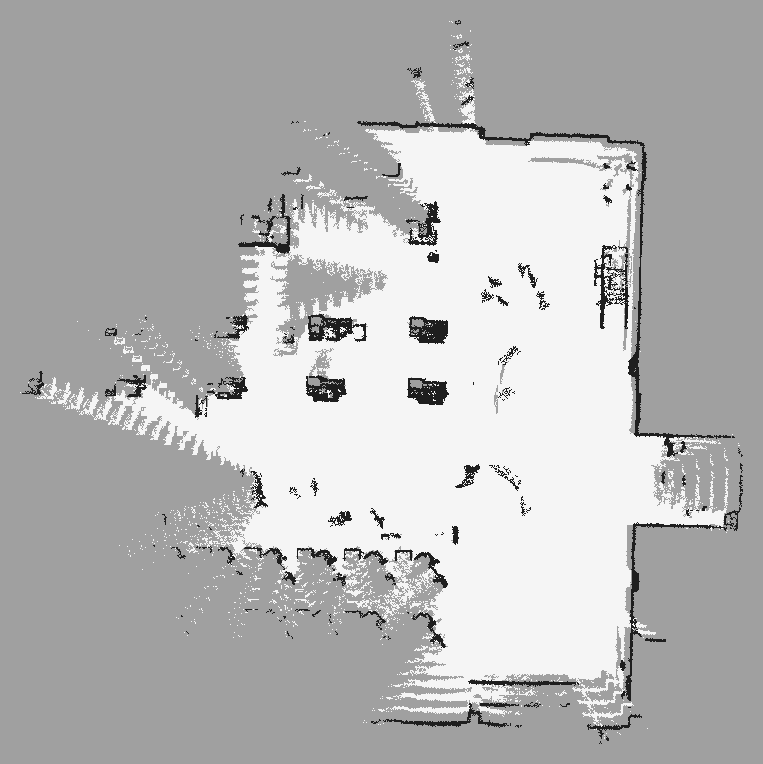
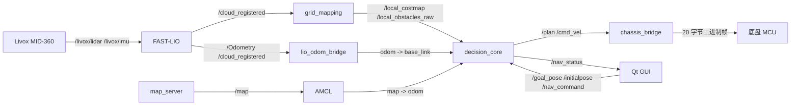

# LiDAR 室内导航系统

基于 **Livox MID-360 + FAST-LIO + ROS 2 Humble** 的四层室内导航系统，包含激光雷达驱动、3D 建图、2D 栅格投影、定位、路径规划、DWA 控制、串口底盘桥和 Qt 操作界面。


## 导航地图

当前实机生成的二维占据栅格地图：



- 地图文件：`maps/occupancy_map.pgm`、`maps/occupancy_map.yaml`
- 实际运行路径：`src/mapping/maps/occupancy_map.yaml`
- 分辨率：0.05 m
- 栅格尺寸：763 × 764

## 仓库结构

```text
.
├── README.md
├── docs/                       # 详细使用与排查文档
├── maps/                       # 导出的导航地图和预览图
├── scripts/                    # 底盘 udev 安装脚本
├── src/
│   ├── driver/livox_ros_driver2
│   ├── mapping/FAST_LIO
│   ├── mapping/grid_mapping
│   ├── mapping/maps
│   ├── navigation/bringup      # 统一 launch / YAML / RViz 配置
│   ├── navigation/chassis      # /cmd_vel -> 底盘串口
│   ├── navigation/decision_core# 全局规划、DWA、行为树
│   ├── navigation/localization # LIO/AMCL TF 与里程计桥
│   ├── GUI/nav_gui             # Qt5 控制台
│   ├── simulation/nav_sim
│   └── calibration/li_init_tools
└── video/                      # 实机导航视频（空目录，稍后上传）
```

## 系统流程



四层结构：

1. **驱动层**：Livox MID-360 发布点云和 IMU；
2. **建图层**：FAST-LIO 输出里程计和配准点云，`grid_mapping` 投影为 2D 栅格；
3. **决策层**：`map_server + AMCL` 定位，`decision_core` 负责 A* 全局规划、DWA/局部避障和行为树；
4. **执行/交互层**：`chassis_bridge` 驱动底盘，Qt GUI 和 RViz 显示状态。

## 环境依赖

- Ubuntu 22.04
- ROS 2 Humble
- Livox-SDK2
- `livox_ros_driver2`
- FAST-LIO（ROS 2 分支）
- Python：`numpy`、`scipy`、`opencv-python`、`PyQt5`、`pyserial`
- C++：Eigen3、PCL、OpenCV

## 编译

```bash
cd ~/nav_system_ws
source /opt/ros/humble/setup.bash
rosdep install --from-paths src --ignore-src -r -y
colcon build
source install/setup.bash
```

建议每个新终端都执行：

```bash
source /opt/ros/humble/setup.bash
source ~/nav_system_ws/install/setup.bash
```

## 底盘准备

1. 给 MiniPC / 底盘控制板上电；
2. 打开遥控器，并切换到 **NAV / 自动模式**，否则串口帧会被底盘忽略；
3. 确认串口别名：

```bash
ls -l /dev/minipc
ls -l /dev/serial/by-id/
```

如果没有 `/dev/minipc`：

```bash
sudo bash scripts/install_chassis_udev.sh
```

底盘串口参数在 `src/navigation/chassis/config/chassis.yaml`：

```yaml
port: /dev/minipc
auto_detect_port: true
protocol: binary
angular_z_target: yaw_speed
invert_linear: true
invert_angular: true
```

## 建图方法

```bash
cd ~/nav_system_ws
source /opt/ros/humble/setup.bash
source install/setup.bash
ros2 launch bringup mapping.launch.py
```

默认启动：

- Livox 驱动；
- FAST-LIO；
- `lio_odom_bridge`；
- `grid_mapping`；
- Qt 控制台；
- RViz。

建图时：

1. 先静止 10~20 秒，等待 IMU 初始化和重力对齐；
2. 低速、缓慢转向，避免急加速和原地打滑；
3. 在 Qt GUI 点击“开始建图”会清空旧全局地图；
4. 走完区域后点击“结束建图并自动保存”，或执行：

```bash
ros2 service call /pointcloud_to_grid/save_map std_srvs/srv/Trigger {}
```

生成：

```text
src/mapping/maps/occupancy_map.pgm
src/mapping/maps/occupancy_map.yaml
```

无界面建图：

```bash
ros2 launch bringup mapping.launch.py use_gui:=false use_rviz:=false
```

## 定位与导航

```bash
cd ~/nav_system_ws
source /opt/ros/humble/setup.bash
source install/setup.bash

ros2 launch bringup navigation.launch.py \
  use_chassis:=true \
  use_gui:=true
```

指定地图：

```bash
ros2 launch bringup navigation.launch.py \
  map_yaml:=$HOME/nav_system_ws/src/mapping/maps/occupancy_map.yaml \
  use_chassis:=true \
  use_gui:=true
```

导航步骤：

1. 在 Qt GUI 或 RViz 用“2D Pose Estimate / 设为初始位姿”给出初始位姿；
2. 在地图上点击目标，或输入 `x/y/yaw` 后点击“发送目标”；
3. GUI 的 `/nav_status` 会显示 `state`、`distance_to_goal`、`blocked` 等；
4. 到达目标后会先对齐目标朝向，并稳定保持 1 秒才判定成功。

### 长廊场景关闭全局重定位

长廊等弱特征场景，AMCL 全局重定位容易把粒子撒满整条走廊。Qt GUI 的“定位 (AMCL)”区域提供：

- `关闭全局重定位`：停止 GUI 调用 `/reinitialize_global_localization`，并让决策层恢复行为跳过全局重定位；
- `启用全局重定位`：恢复上述功能。

关闭后建议先用“设为初始位姿”给出大致位置和朝向，再进行局部跟踪导航。

## 主要 Topic

| Topic | 类型 | 说明 |
|---|---|---|
| `/livox/lidar` | `livox_ros_driver2/msg/CustomMsg` | MID-360 点云 |
| `/livox/imu` | `sensor_msgs/Imu` | MID-360 IMU |
| `/cloud_registered` | `sensor_msgs/PointCloud2` | FAST-LIO 配准点云 |
| `/Odometry` | `nav_msgs/Odometry` | FAST-LIO 里程计 |
| `/local_costmap` | `nav_msgs/OccupancyGrid` | 局部膨胀代价地图 |
| `/local_obstacles_raw` | `nav_msgs/OccupancyGrid` | 膨胀前局部障碍 |
| `/grid_map/global` | `nav_msgs/OccupancyGrid` | 累积全局栅格 |
| `/map` | `nav_msgs/OccupancyGrid` | `map_server` 加载的导航地图 |
| `/scan` | `sensor_msgs/LaserScan` | 点云转 2D 扫描，供 AMCL |
| `/amcl_pose` | `geometry_msgs/PoseWithCovarianceStamped` | AMCL 位姿 |
| `/robot_pose` | `geometry_msgs/PoseStamped` | map 坐标系机器人位姿 |
| `/plan` | `nav_msgs/Path` | 全局路径 |
| `/cmd_vel` | `geometry_msgs/Twist` | 速度指令 |
| `/goal_pose` | `geometry_msgs/PoseStamped` | 导航目标 |
| `/initialpose` | `geometry_msgs/PoseWithCovarianceStamped` | 初始位姿 |
| `/nav_status` | `std_msgs/String` | 决策层 JSON 状态 |
| `/nav_command` | `std_msgs/String` | `cancel / replan / estop / resume / relocalize_on / relocalize_off` |
| `/wheel_odom` | `nav_msgs/Odometry` | 底盘指令积分/反馈，不用于导航里程计 |
| `/chassis_status` | `std_msgs/String` | 底盘模式与当前下发速度 |

## TF 树

```text
map
 └── odom                (AMCL 或静态 map->odom)
      ├── base_link       (lio_odom_bridge)
      └── camera_init     (静态)
           └── body       (FAST-LIO)
                └── livox_frame (静态)
```

关键参数：

- `base_to_body_x: -0.10`：MID-360 在车体中心前方 10 cm；
- `base_to_body_yaw: 3.141592653589793`：当前装车实测为 180°；
- FAST-LIO 的 `camera_init` 已与重力对齐，2D 栅格高度滤波才有意义。

## 主要修改过的配置

### FAST-LIO：`src/mapping/FAST_LIO/config/mid360.yaml`


extrinsic_est_en: false
blind: 0.5


### 栅格投影：`src/mapping/grid_mapping/config/grid_params.yaml`


min_range: 1.0
z_min: 0.7
z_max: 2.0
local_z_min: 0.7
local_z_max: 2.0
inflation_radius: 0.35
inflate_unknown: false
fill_enclosed_unknown: true
despeckle_obstacles: true
obstacle_min_neighbors: 1
obstacle_min_cluster_cells: 3


- 过滤车体近处和过低/过高回波；
- 被空闲格完全包围的未知空洞填成空地，避免稀疏点云被当成墙；
- 删除孤立单格和小障碍簇，保留连续墙线；
- 只膨胀已知空闲格，避免未观测区域变成大片紫色假障碍。


### 启动参数

`navigation.launch.py` / `mapping.launch.py` 默认：

```yaml
base_to_body_x: -0.10
base_to_body_yaw: 3.141592653589793
chassis_port: /dev/minipc
chassis_protocol: binary
chassis_angular_target: yaw_speed
chassis_invert_linear: true
```

实际问题排查过程

底盘无法驱动：
排查了串口通信协议
fsatlio是否拉起和正常发布TF变换
底盘桥接权限
遥控器


## 已知限制

- 2D 栅格依赖高度带滤波，地面特别光滑或雷达安装角度变化时需要重新标定；
- 光滑地面轮子打滑会让 FAST-LIO 里程计漂移，必要时降低 `max_linear/max_dv`；
- 长廊等弱特征场景 AMCL 全局重定位可能跳变，建议关闭全局重定位并手动给初始位姿；
- `/wheel_odom` 不是高精度轮速反馈，导航主要使用 FAST-LIO 的 `/Odometry`；
- 底盘必须处于遥控器 NAV/自动模式，否则串口帧不会被执行。


ai使用情况


在把各个开源文件补充依赖等使用了ai
解决终端报错
编写系统缺少的一些节点
改良导航算法
